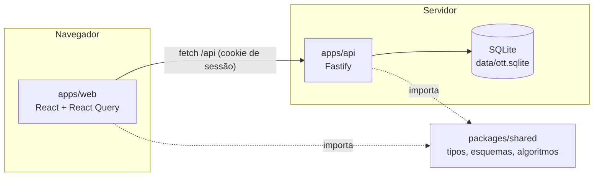

# 1. Arquitetura

> Estado: `[implementado]` para tudo o que está descrito aqui, salvo marcação contrária.

## 1.1 Visão geral

O Open Task Tracker é um monorepo npm com três pacotes:

| Pacote | Pasta | Papel |
|---|---|---|
| `@ott/shared` | `packages/shared` | Tipos das entidades, esquemas de validação (zod), datas sem fuso, durações e todos os algoritmos de planejamento (calendário, cascata, caminho crítico, resumo, capacidade, feriados). Não depende de nada do projeto. |
| `@ott/api` | `apps/api` | Servidor HTTP (Fastify) com SQLite nativo do Node. Autenticação, regras de negócio, relatórios e, em produção, entrega da web compilada. |
| `@ott/web` | `apps/web` | Aplicação React (Vite) com as telas no estilo do Toggl Track. |



Regra de dependência: `shared` não importa ninguém; `api` e `web` importam `shared`;
`web` e `api` nunca importam uma à outra.

## 1.2 Estrutura de pastas

```
open-task-tracker/
  apps/
    api/
      build.mjs              empacota a API num arquivo (esbuild)
      src/
        index.ts             ponto de entrada (config, banco, servidor)
        app.ts               raiz de composição: plugins, sessão, erros, rotas
        config.ts            variáveis de ambiente
        db/                  conexão SQLite (database.ts) e migrações
        http/                erros, validação, guardas de sessão e workspace
        modules/<recurso>/   repo.ts (SQL), service.ts (regras), routes.ts (HTTP)
        seed/                dados de demonstração (npm run seed)
      test/                  testes de integração com app.inject
    web/
      index.html             aplica o tema antes do React (sem piscar)
      src/
        main.tsx             monta o React
        app/                 App, roteador, RootLayout, AuthGate, sessão, tema
        api/                 cliente HTTP e hooks do React Query por recurso
        components/          ui/ (kit), pickers/ (seletores), charts/ (gráficos)
        features/<tela>/     telas e componentes exclusivos de cada tela
        i18n/                dicionários pt-BR e en
        layout/              AppShell, Sidebar, PageHeader, Logo
        lib/                 formatação, calendário de trabalho, hooks genéricos
        styles/              tokens.css e base.css
  packages/shared/
    src/                     constants, entities, schemas, dates, duration,
                             scheduling, capacity, holidays, api-types
    test/                    testes unitários dos algoritmos
  scripts/                   dev.mjs (sobe API e web), check-text.mjs
  docs/                      esta documentação
```

## 1.3 Boot

### API (`apps/api/src/index.ts`)

1. `loadConfig()` lê `PORT`, `HOST`, `DATABASE_PATH`, `COOKIE_SECURE`, `WEB_DIST_PATH`,
   `SESSION_DAYS` e `LOG_LEVEL` (ver [02-tecnologias.md](02-tecnologias.md), seção 2.4).
2. `openDatabase()` cria a pasta do arquivo, abre o SQLite, liga `foreign_keys`,
   `busy_timeout` e WAL, e roda `runMigrations()` (migrações pendentes em transação).
3. `purgeExpiredSessions()` limpa sessões vencidas.
4. `buildApp()` monta o Fastify (seção 1.4) e `listen()` abre a porta.
5. `SIGINT` e `SIGTERM` fecham o servidor e o banco.

### Web (`apps/web/src/main.tsx`)

1. `index.html` aplica o último tema salvo (`ott.theme`) antes de carregar o React.
2. `App` cria o `QueryClient` (mutações com erro viram aviso, salvo `meta.silent`) e o
   roteador.
3. `RootLayout` lê a sessão, escolhe idioma (preferência do usuário ou do navegador),
   aplica o tema e fornece i18n, confirmações e avisos.
4. `AuthGate` protege as rotas internas: sem sessão, redireciona para `/login` guardando
   o destino; com sessão, fornece `SessionProvider` (usuário, workspace atual, lista de
   workspaces) e o `AppShell`.
5. `AppShell` monta a barra lateral, o painel de tarefa global, a busca rápida, os
   atalhos de teclado e o título da aba com o cronômetro.

## 1.4 Composição da API

`app.ts` registra, nesta ordem:

1. Decoradores `db` e `config` na instância e `user`, `sessionToken` e `workspace` na
   requisição.
2. Remoção do parser `text/plain` (proteção contra CSRF por formulário).
3. `@fastify/cookie` e o gancho `onRequest` que resolve a sessão a partir do cookie
   `ott_session`.
4. O tratador de erros: `AppError` vira `{ error: { code, message, details } }` com o
   status certo; erros 4xx do Fastify mantêm o status; o resto vira 500 `INTERNAL`.
5. As rotas em `/api`:
   - `authRoutes`: `/auth/*` e `/me/*`;
   - `workspaceCollectionRoutes`: listar e criar workspaces;
   - um escopo `/workspaces/:workspaceId` com o gancho `requireWorkspace`, onde ficam
     workspace, membros, clientes, tags, feriados, projetos, tarefas, dependências,
     apontamentos e relatórios.
6. Em produção, `@fastify/static` serve `apps/web/dist` e o tratador de rota não
   encontrada devolve `index.html` para qualquer GET fora de `/api/` (rotas do React
   Router).

Cada módulo de `modules/` segue a mesma divisão:

| Arquivo | Responsabilidade | Pode |
|---|---|---|
| `repo.ts` | SQL e conversão de linha (snake_case) para entidade (camelCase) | só acessar o banco |
| `service.ts` | Regras de negócio, validação contra o estado do banco, transações | chamar repos de qualquer módulo e o `shared` |
| `routes.ts` | Formato da entrada (zod), guardas de permissão, status HTTP | chamar service e repo do próprio módulo |

Módulos simples (clientes, tags, membros, projetos, feriados) não têm `service.ts`.

## 1.5 Fluxo de dados na web

- **Fonte única no cliente: React Query.** Cada recurso tem hooks em
  `apps/web/src/api/` com chaves de `keys.ts`. Tudo de um workspace fica sob
  `['ws', id, ...]`; trocar de workspace remove esse cache inteiro.
- **Tarefas do workspace inteiro num só cache** (`keys.tasks`). Lista, Quadro, Gantt,
  Linha do tempo, painel e busca leem a mesma lista, então nunca mostram versões
  diferentes da mesma tarefa.
- **Atualização otimista** nos pontos de arrastar: datas no Gantt e na Linha do tempo
  (`useScheduleTasks`), status e campos de tarefa (`useUpdateTask`) e horários no
  calendário do cronômetro (`useUpdateTimeEntry`). Em erro, o cache volta ao estado
  anterior e o aviso aparece.
- **Invalidação por efeito colateral.** Exemplo: parar o cronômetro invalida cronômetro,
  apontamentos, tarefas (tempo registrado), projetos e relatórios
  (`invalidateTracking` em `api/timeEntries.ts`).
- **Estado de interface por pessoa** (visão escolhida, agrupamento, zoom do Gantt) fica
  no `localStorage` com chaves `ott.*` via `useStoredState`. Nunca guarde dado de
  negócio ali.

## 1.6 Telas e rotas da web

| Rota | Tela | Pasta |
|---|---|---|
| `/login`, `/signup` | Entrar e criar conta | `features/auth` |
| `/timer` | Cronômetro (Calendário, Lista, Planilha) | `features/timer` |
| `/reports` | Relatórios (Resumo, Detalhado, Semanal) | `features/reports` |
| `/projects` | Lista de projetos | `features/projects` |
| `/projects/:id` | Visão geral do projeto | `features/projects` |
| `/projects/:id/gantt` | Cronograma (Gantt) | `features/gantt` |
| `/projects/:id/tasks` | Tarefas do projeto (Lista e Quadro) | `features/projects`, `features/tasks` |
| `/tasks` | Tarefas (Lista e Quadro) | `features/tasks` |
| `/timeline` | Linha do tempo (capacidade) | `features/timeline` |
| `/members`, `/clients`, `/tags` | Gestão | `features/manage` |
| `/settings/profile`, `/settings/workspace` | Configurações | `features/settings` |

O painel de tarefa (`features/tasks/TaskPanelContext.tsx`) e a busca rápida
(`features/search`) são globais e abrem por cima de qualquer tela.

## 1.7 Produção

`npm run build` compila a web (`apps/web/dist`) e empacota a API (`apps/api/dist/index.js`,
com `@ott/shared` dentro e dependências de `node_modules` fora). `npm start` sobe um único
processo Node que responde a API e a interface na mesma porta. O banco é um arquivo; para
backup, copie o `.sqlite` com o servidor parado ou use `sqlite3 .backup`.

Pontos `[planejado]`: imagem Docker, limite de tentativas de login, envio de convite por
e-mail e paginação no servidor para workspaces muito grandes (hoje as tarefas do workspace
vêm numa só resposta; ver [04-padrao-ui-e-componentes.md](04-padrao-ui-e-componentes.md),
seção 4.6).
