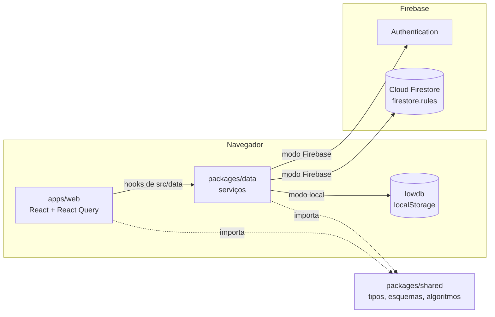

# 1. Arquitetura

> Estado: `[implementado]` para tudo o que está descrito aqui, salvo marcação contrária.

## 1.1 Visão geral

O Open Task Tracker é um site estático (sem servidor próprio) que roda inteiro no
navegador. Os dados ficam no **Firebase** (Authentication e Cloud Firestore) ou, quando
o Firebase não está configurado ou não responde, no próprio navegador com o **lowdb**
sobre o `localStorage`. As mesmas regras de negócio valem nos dois modos.

O monorepo npm tem três pacotes:

| Pacote | Pasta | Papel |
|---|---|---|
| `@ott/shared` | `packages/shared` | Tipos das entidades, esquemas de validação (zod), datas sem fuso, durações e todos os algoritmos de planejamento (calendário, cascata, caminho crítico, resumo, capacidade, feriados). Não depende de nada do projeto. |
| `@ott/data` | `packages/data` | Camada de dados: contrato de armazenamento (`DocStore`) com as implementações Firestore e lowdb, autenticação (Firebase Auth ou contas locais), os serviços com as regras de negócio e a escolha automática do modo. |
| `@ott/web` | `apps/web` | Aplicação React (Vite) com as telas no estilo do Toggl Track. |



Regra de dependência: `shared` não importa ninguém; `data` importa `shared`, lowdb e
firebase; `web` importa `shared` e `data`. Nada importa a `web`.

## 1.2 Estrutura de pastas

```
open-task-tracker/
  apps/web/
    index.html               aplica o tema antes do React (sem piscar)
    vite.config.ts           base (subcaminho do Pages) e envDir na raiz
    src/
      main.tsx               conecta a camada de dados e monta o React
      app/                   App (sincronia entre abas), roteador, RootLayout, AuthGate, sessão, tema
      data/                  backend.ts (conexão) e hooks do React Query por recurso
      components/            ui/ (kit), pickers/ (seletores), charts/ (gráficos), DataModeNotice
      features/<tela>/       telas e componentes exclusivos de cada tela
      i18n/                  dicionários pt-BR e en
      layout/                AppShell, Sidebar, PageHeader, Logo
      lib/                   formatação, calendário de trabalho, hooks genéricos
      styles/                tokens.css e base.css
  packages/data/
    src/
      backend.ts             fachada usada pela web (createBackend)
      connect.ts             escolha do modo (Firebase, local ou queda para local)
      errors.ts              AppError com código estável e parse() com zod
      store/                 types.ts (DocStore, Batch), schema.ts (caminhos e documentos), local.ts (lowdb)
      auth/                  types.ts (AuthGateway), local.ts (contas locais com PBKDF2)
      firebase/index.ts      FirestoreStore, FirebaseAuthGateway, connectFirebase (carregado sob demanda)
      services/              regras de negócio por recurso (sessão, workspaces, membros e convites,
                             cadastros, projetos, tarefas, apontamentos, relatórios, demonstração)
    test/                    suites.ts (as mesmas suítes nos dois modos), rules.ts (regras do Firestore)
  packages/shared/
    src/                     constants, entities, results, schemas, dates, duration,
                             scheduling, capacity, holidays, ids
    test/                    testes unitários dos algoritmos
  firestore.rules            regras de acesso do Firestore
  firestore.indexes.json     índice composto usado pelo cronômetro
  firebase.json              regras, índices e portas dos emuladores
  .github/workflows/         ci.yml (pull requests) e deploy.yml (GitHub Pages)
  scripts/check-text.mjs     verificação de caracteres proibidos
  docs/                      esta documentação
```

## 1.3 Boot da web

1. `index.html` aplica o último tema salvo (`ott.theme`) antes de carregar o React.
2. `main.tsx` chama `connectBackend()` (`apps/web/src/data/backend.ts`), que lê as
   variáveis `VITE_*` e chama `connect()` de `@ott/data` (seção 1.4). Só depois disso
   o React é montado; se o modo foi forçado para Firebase e a conexão falhou, aparece
   uma mensagem de erro no lugar do app.
3. `App` cria o `QueryClient` (mutações com erro viram aviso, salvo `meta.silent`), o
   roteador (com `basename` igual ao `BASE_URL` do Vite) e o `DataSync`, que invalida a
   sessão quando o login muda (outra aba, expiração no Firebase) e, no modo local, relê
   os dados quando outra aba grava no `localStorage`.
4. `RootLayout` lê a sessão, escolhe idioma (preferência do usuário ou do navegador),
   aplica o tema e fornece i18n, confirmações e avisos.
5. `RequireLogin` protege a página de convite (pede login, mas não workspace).
   `AuthGate` protege as rotas internas: sem sessão, redireciona para `/login` guardando
   o destino; com sessão, fornece `SessionProvider` (usuário, workspace atual, lista de
   workspaces) e o `AppShell`.
6. `AppShell` monta a barra lateral, a faixa de aviso do modo local, o painel de tarefa
   global, a busca rápida, os atalhos de teclado e o título da aba com o cronômetro.

## 1.4 Escolha do modo de dados

`connect()` (`packages/data/src/connect.ts`) decide uma vez, na abertura:

| Situação | Modo | Aviso na tela |
|---|---|---|
| `VITE_DATA_MODE=local` | local | selo "Modo local" (escolha da configuração) |
| Configuração do Firebase incompleta ou ausente | local | selo "Modo local" e nota no login |
| Firebase configurado e o Firestore respondeu em até 8 s | Firebase | nenhum |
| Firebase configurado, mas sem resposta, projeto inexistente ou erro de rede | local | faixa de alerta no topo, selo e nota no login |
| `VITE_DATA_MODE=firebase` e o Firebase falhou | nenhum | mensagem de erro no lugar do app |

A sonda (`connectFirebase`) lê um documento qualquer direto do servidor. Qualquer
resposta serve, inclusive "sem permissão" (ninguém logado ainda); só falha de rede,
demora ou configuração inválida fazem cair no modo local. O SDK do Firebase é
carregado por import dinâmico: no modo local ele nem é baixado.

A queda para o modo local é por sessão de navegador: os dados criados nela ficam só
naquele navegador e não sobem para o Firebase quando a conexão volta. Por isso a faixa
de alerta. Veja [07-fluxos-aplicacao.md](07-fluxos-aplicacao.md), seção 7.1.

## 1.5 Camada de dados

A web só conhece a fachada `Backend` (`packages/data/src/backend.ts`), agrupada como
a antiga API HTTP: `session`, `workspaces`, `members`, `clients`, `tags`, `holidays`,
`projects`, `tasks`, `dependencies`, `timeEntries` e `reports`.

| Parte | Responsabilidade | Pode |
|---|---|---|
| `services/*.ts` | Validação (zod), regras de negócio, guardas (`loadWorkspace`, `loadAdminWorkspace`), montagem do lote de gravação | usar `DocStore`, `AuthGateway` e `@ott/shared` |
| `store/types.ts` | Contrato `DocStore`: `get`, `list` com filtros simples, `commit` de lote atômico, `increment`, `arrayUnion`, `arrayRemove` | nada além do contrato |
| `store/local.ts` | Implementação lowdb: coleções em memória, relidas do `localStorage` antes de gravar | só lowdb |
| `firebase/index.ts` | Implementação Firestore e Firebase Auth, tradução dos erros do SDK para os códigos da web | só o SDK do Firebase |
| `auth/local.ts` | Contas do modo local no mesmo lowdb, senha com PBKDF2 | Web Crypto e lowdb |

Os serviços leem o que precisam, calculam em memória (por exemplo, a cascata sobre
todas as tarefas do workspace) e gravam só os documentos que mudaram, num único lote
(`Batch`). Assim o mesmo código vale para o Firestore e para o lowdb, e uma operação
nunca fica pela metade.

## 1.6 Fluxo de dados na web

- **Fonte única no cliente: React Query.** Cada recurso tem hooks em
  `apps/web/src/data/` com chaves de `keys.ts`. Tudo de um workspace fica sob
  `['ws', id, ...]`; trocar de workspace remove esse cache inteiro.
- **Tarefas do workspace inteiro num só cache** (`keys.tasks`). Lista, Quadro, Gantt,
  Linha do tempo, painel e busca leem a mesma lista, então nunca mostram versões
  diferentes da mesma tarefa.
- **Atualização otimista** nos pontos de arrastar: datas no Gantt e na Linha do tempo
  (`useScheduleTasks`), status e campos de tarefa (`useUpdateTask`) e horários no
  calendário do cronômetro (`useUpdateTimeEntry`). Em erro, o cache volta ao estado
  anterior e o aviso aparece.
- **Invalidação por efeito colateral.** Exemplo: parar o cronômetro invalida cronômetro,
  apontamentos, tarefas (tempo registrado), projetos e relatórios
  (`invalidateTracking` em `data/timeEntries.ts`).
- **Estado de interface por pessoa** (visão escolhida, agrupamento, zoom do Gantt) fica
  no `localStorage` com chaves `ott.*` via `useStoredState`. Nunca guarde dado de
  negócio ali; os dados do modo local ficam só na chave `ott.local.v1`, gerida pelo
  lowdb.

## 1.7 Telas e rotas da web

| Rota | Tela | Pasta |
|---|---|---|
| `/login`, `/signup` | Entrar e criar conta (e demonstração no modo local) | `features/auth` |
| `/invite/:workspaceId/:inviteId` | Aceitar convite | `features/auth` |
| `/timer` | Cronômetro (Calendário, Lista, Planilha) | `features/timer` |
| `/reports` | Relatórios (Resumo, Detalhado, Semanal) | `features/reports` |
| `/projects` | Lista de projetos | `features/projects` |
| `/projects/:id` | Visão geral do projeto | `features/projects` |
| `/projects/:id/gantt` | Cronograma (Gantt) | `features/gantt` |
| `/projects/:id/tasks` | Tarefas do projeto (Lista e Quadro) | `features/projects`, `features/tasks` |
| `/tasks` | Tarefas (Lista e Quadro) | `features/tasks` |
| `/timeline` | Linha do tempo (capacidade) | `features/timeline` |
| `/members`, `/clients`, `/tags` | Gestão (membros e convites, clientes, tags) | `features/manage` |
| `/settings/profile`, `/settings/workspace` | Configurações | `features/settings` |

O painel de tarefa (`features/tasks/TaskPanelContext.tsx`) e a busca rápida
(`features/search`) são globais e abrem por cima de qualquer tela.

## 1.8 Publicação

`npm run build` gera um site estático em `apps/web/dist`. O workflow
`.github/workflows/deploy.yml` publica esse site no **GitHub Pages** a cada push na
`main`: monta o build com o subcaminho do Pages (`VITE_BASE_PATH`) e a configuração do
Firebase vinda dos secrets, copia `index.html` para `404.html` (o Pages devolve esse
arquivo para qualquer rota desconhecida, e o React Router resolve a rota) e, se houver
conta de serviço, publica `firestore.rules` e `firestore.indexes.json`. Passo a passo em
[02-tecnologias.md](02-tecnologias.md), seção 2.6.

Pontos `[planejado]`: sincronizar para o Firebase o que foi feito no modo local durante
uma queda, limite de tentativas de login (hoje o Firebase Auth já limita), envio de
convite por e-mail e paginação para workspaces muito grandes (hoje as tarefas do
workspace vêm numa só leitura; ver
[04-padrao-ui-e-componentes.md](04-padrao-ui-e-componentes.md), seção 4.6).
