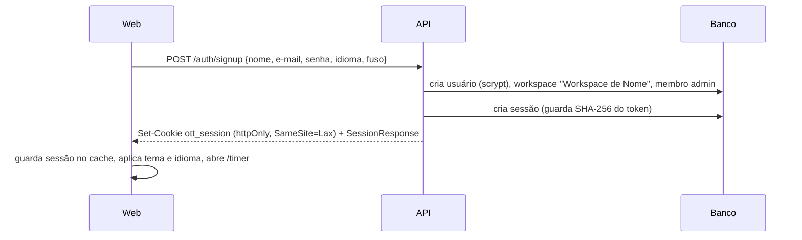
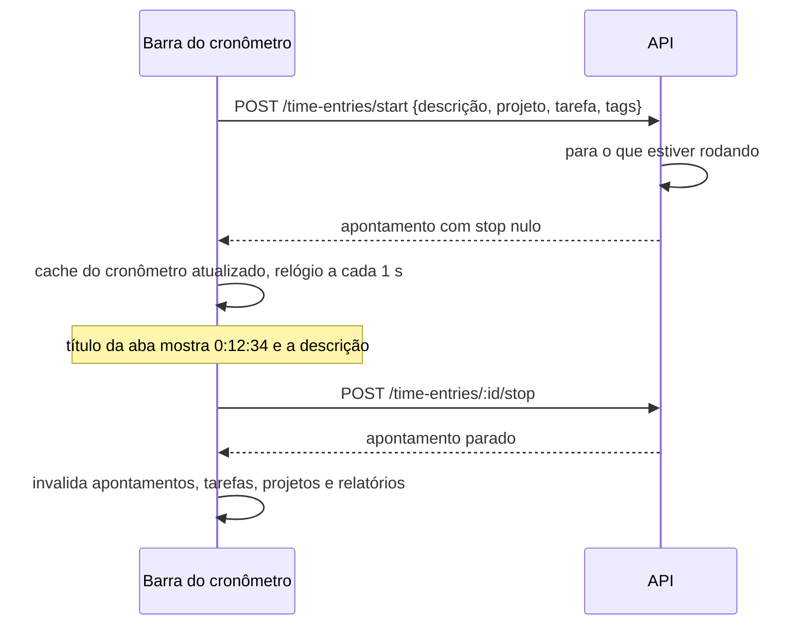
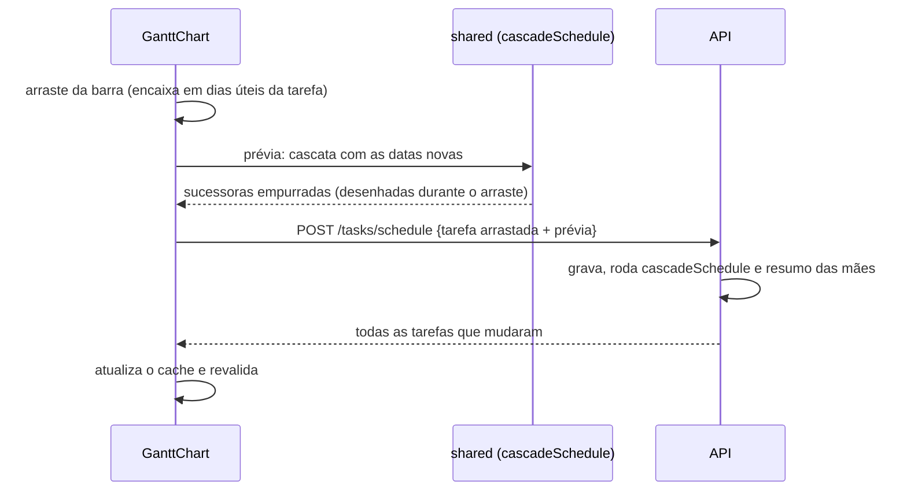
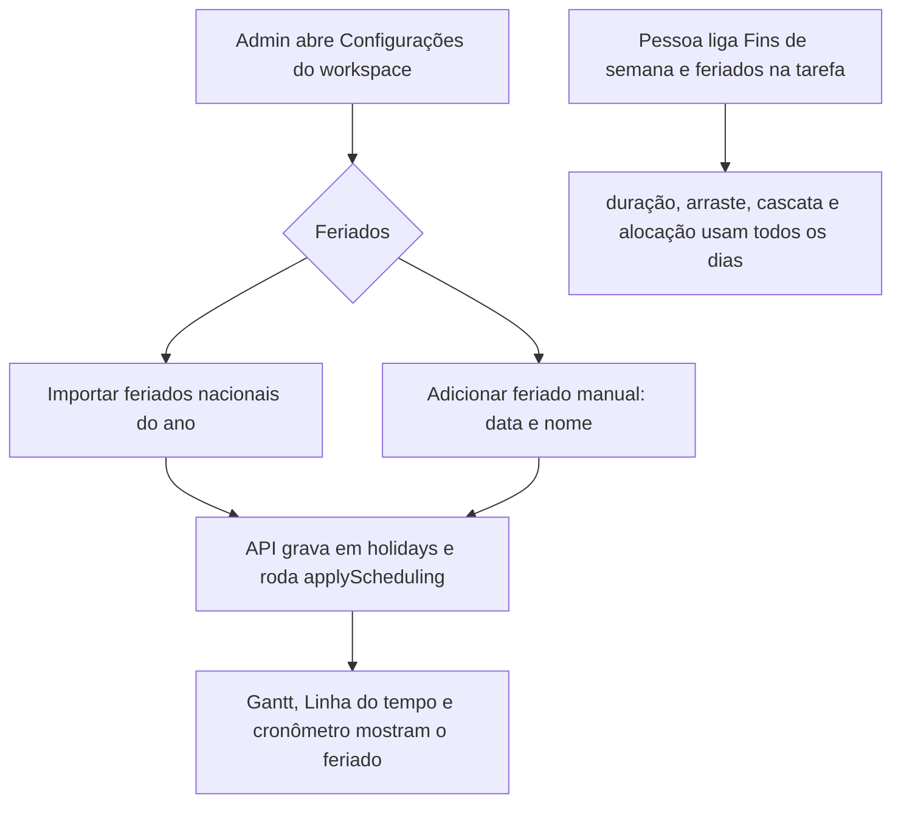

# 7. Fluxos da aplicação

> Cada fluxo indica onde a regra mora. Mudou um fluxo? Atualize esta página e o teste
> correspondente.

## 7.1 Cadastro, login e sessão

- Login com e-mail inexistente ou senha errada responde a mesma coisa (não revela quem
  tem conta).
- `GET /auth/session` sem sessão responde 401; a web trata como "sem login" e o
  `AuthGate` redireciona para `/login`, lembrando o destino para voltar depois.
- Workspace atual removido ou desativado: a API escolhe o primeiro disponível; sem
  nenhum, a web mostra "Novo workspace".
- Trocar a senha encerra as outras sessões da pessoa.
- Trocar de workspace limpa todo o cache `['ws', ...]` da web.

## 7.2 Cronômetro

Regras (`apps/api/src/modules/time-entries/service.ts`):

1. Iniciar para o cronômetro que estiver rodando (em qualquer workspace) e cria um novo
   com `stop` nulo. O banco recusa dois rodando para a mesma pessoa.
2. Apontamento ligado a tarefa herda o projeto da tarefa. Trocar o projeto de um
   apontamento solta a tarefa que era do projeto anterior.
3. Sem "faturável" explícito, herda do projeto.
4. Só a própria pessoa edita seus apontamentos.
5. Fim antes do início, duração acima de 999 h ou cronômetro começando no futuro são
   recusados (`INVALID_RANGE`).

Com o cronômetro rodando, editar descrição, projeto, tags ou faturável na barra altera o
apontamento em andamento na hora. A barra lateral mostra um cartão do cronômetro
rodando em qualquer tela que não seja o Cronômetro.

**Modo manual** (ícone abaixo do relógio): a barra troca o relógio por início, fim, data
e duração; "Adicionar" cria o apontamento. Fim antes do início significa que passou da
meia-noite.

## 7.3 Calendário, Lista e Planilha

- **Calendário**: clicar e arrastar no vazio cria um apontamento (passos de 15 min; clique
  simples cria 30 min) e abre o editor para descrição e projeto. Arrastar um apontamento
  move, inclusive para outro dia; arrastar a borda de baixo muda o fim. A gravação é
  otimista. Apontamento que passa da meia-noite aparece nos dois dias.
- **Lista**: agrupada por dia, com total diário; descrição e projeto editáveis na
  linha; "continuar" inicia um cronômetro igual.
- **Planilha**: linhas por projeto e tarefa, colunas por dia. Digitar um total maior cria
  um apontamento com a diferença, começando depois do último apontamento do dia (ou às
  9h). Digitar um total menor encurta ou remove os apontamentos mais recentes daquela
  célula.

## 7.4 Tarefas

- Painel lateral global (`useTaskPanel`). Tarefa nova trabalha em rascunho e só grava em
  "Criar tarefa" (responsável padrão: quem está criando). Tarefa existente grava cada
  alteração na hora; nome, descrição e notas gravam ao sair do campo.
- Subtarefa herda o projeto da mãe. Mudar o projeto da mãe leva a árvore junto.
- Concluir marca progresso 100% e `completedAt`; reabrir volta o progresso a 0.
- Datas: só início vira tarefa de um dia; marco tem início igual ao fim; início depois da
  entrega é recusado.
- Status, datas e progresso da tarefa-mãe vêm das filhas (seção 7.6).
- A opção **"Fins de semana e feriados"** libera a tarefa para dias não úteis (seção 7.7).
- Na Lista, o agrupamento por data usa a entrega (ou o início): Atrasadas, Hoje, Amanhã,
  Esta semana, Próxima semana, Mais adiante, Sem data. No Quadro, arrastar o cartão para
  outra coluna muda o status.

## 7.5 Gantt e dependências

- Arrastar a barra move; as bordas mudam início e fim. Mover preserva a duração em dias
  úteis. Barras de grupo (mães) não se arrastam: seguem as filhas.
- Clicar numa linha sem datas agenda a tarefa no dia clicado, com duração estimada pela
  estimativa (8 h por dia) ou 1 dia.
- Arrastar a bolinha da ponta de uma barra até outra cria dependência término-início.
  Pelo painel dá para escolher o tipo (FS, SS, FF, SF) e o atraso.
- A API recusa ligar a tarefa a ela mesma, mãe com filha, ligação repetida (em qualquer
  direção) e ciclos, inclusive ciclos que passam pela hierarquia.
- Clicar numa seta pede confirmação e remove a dependência.
- Com **agendamento automático** desligado (configuração do workspace), nada é empurrado;
  o caminho crítico continua sendo calculado.

## 7.6 Resumo das tarefas-mãe

Sempre que datas, progresso, status, hierarquia ou a opção de dias não úteis mudam,
`applyScheduling` (API) roda nesta ordem:

1. Cascata de dependências, se o agendamento automático estiver ligado.
2. Para cada mãe: início = menor início das filhas, fim = maior fim, progresso = média
   ponderada pela duração, status = concluída se todas concluídas, em andamento se alguma
   começou, a fazer caso contrário.

## 7.7 Fins de semana e feriados

Há dois controles, complementares:

| Controle | Onde | Efeito |
|---|---|---|
| Dias úteis do workspace | Configurações do workspace | Marcar sábado ou domingo torna o dia útil para todas as tarefas e para a capacidade |
| Feriados do workspace | Configurações do workspace, seção Feriados | Datas que deixam de ser úteis mesmo caindo em dia útil |
| "Fins de semana e feriados" na tarefa | Painel da tarefa | Só aquela tarefa usa todos os dias do calendário |

- A importação traz os feriados nacionais do Brasil (Confraternização, Sexta-feira Santa,
  Tiradentes, Dia do Trabalho, Independência, Nossa Senhora Aparecida, Finados,
  Proclamação da República, Consciência Negra a partir de 2024 e Natal) e, se pedido, os
  pontos facultativos (Carnaval e Corpus Christi). Datas já cadastradas ficam como estão.
  Feriados estaduais, municipais e recessos entram pelo cadastro manual.
- Mudar feriados não move tarefas sozinho, exceto pela cascata (que só empurra quando uma
  dependência fica violada). As durações em dias úteis exibidas mudam na hora.
- Na Linha do tempo, carga numa tarefa liberada em fim de semana ou feriado aparece em
  vermelho: a capacidade da pessoa nesses dias é zero.

## 7.8 Linha do tempo (capacidade)

- Uma faixa por pessoa (ou por projeto), com as tarefas abertas que têm data, empilhadas
  sem sobreposição. "Sem responsável" sempre aparece primeiro.
- Coluna da esquerda: horas livres ou acima no período escolhido (esta semana, próxima
  semana, este mês), comparando a alocação com a capacidade semanal do membro.
- Embaixo de cada faixa, a carga planejada por dia; em vermelho quando passa da
  capacidade do dia.
- Arrastar a barra move as datas da tarefa; arrastar a borda direita muda a entrega.

## 7.9 Relatórios

1. A web monta a consulta com período, fuso e filtros (uma linha de filtros só, acima de
   tudo).
2. A API filtra largo em UTC (um dia de folga de cada lado), converte cada início para o
   dia local e aplica os filtros exatos.
3. Resumo: blocos de totais, colunas por dia (por semana acima de 31 dias, por mês acima
   de 120), rosca por projeto com tabela e tabela por projeto com subgrupos por descrição.
4. Exportar CSV abre `GET /reports/detailed.csv` com os mesmos filtros.

## 7.10 Membros

- Admin adiciona por nome e e-mail. Se o e-mail já tem conta, a pessoa entra no
  workspace; se não, a API cria a conta com senha temporária, mostrada uma única vez para
  o admin repassar (instalação própria, sem servidor de e-mail; convite por e-mail é
  `[planejado]`).
- O workspace nunca fica sem administrador ativo (`LAST_ADMIN`); ninguém remove a si
  mesmo (`REMOVE_SELF`).
- Desativar mantém os apontamentos e tira a pessoa da Linha do tempo e dos seletores.
