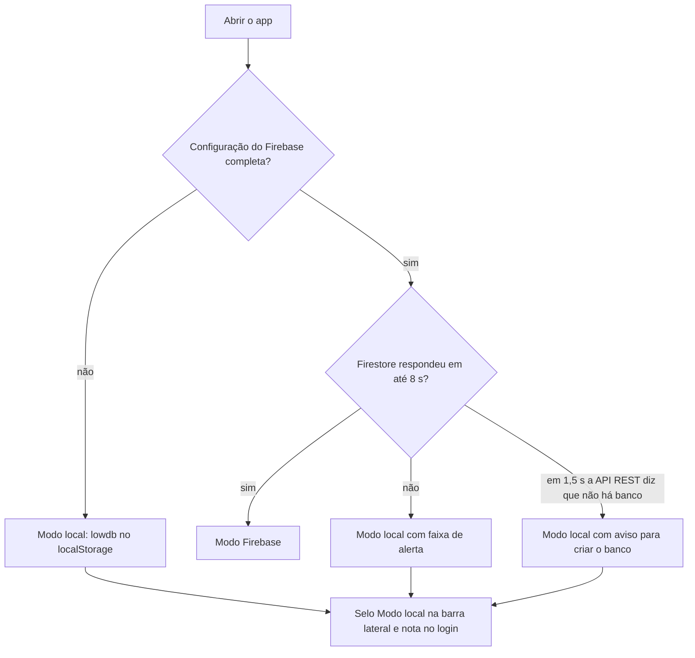
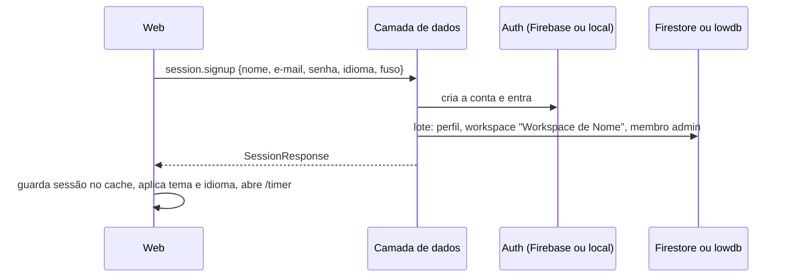
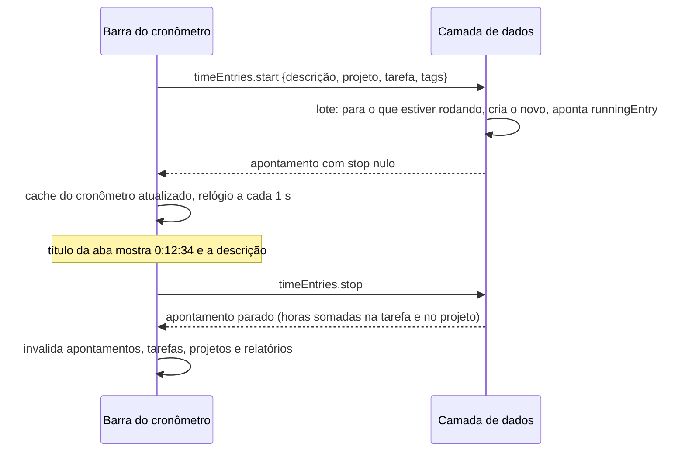
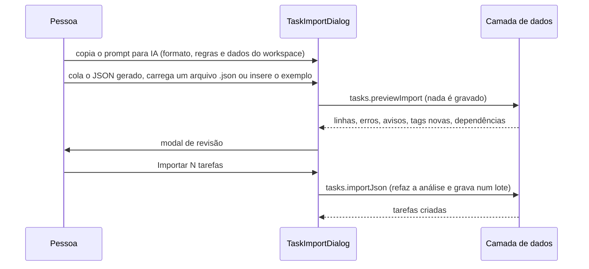
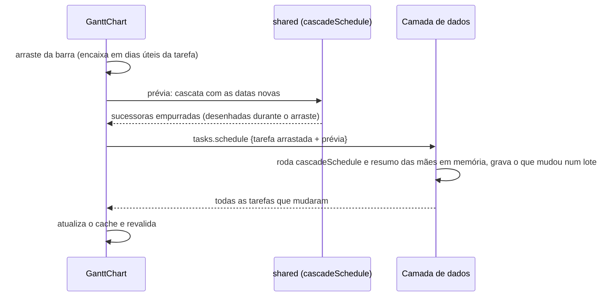
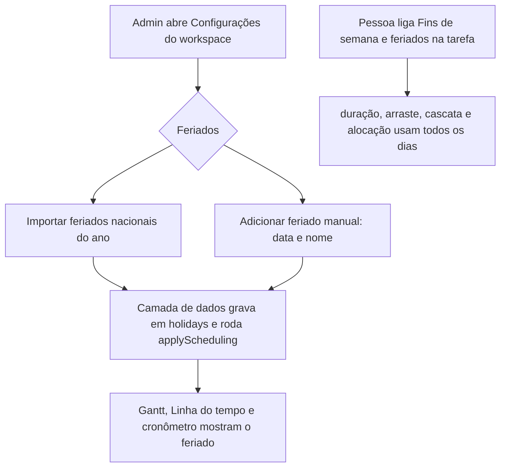
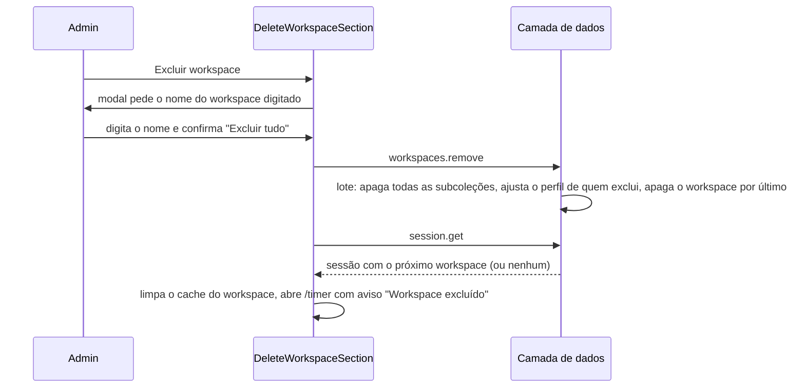

# 7. Fluxos da aplicação

> Cada fluxo indica onde a regra mora. Mudou um fluxo? Atualize esta página e o teste
> correspondente.

## 7.1 Modo de dados, cadastro, login e sessão

Na abertura, `connect()` escolhe o modo (tabela completa em
[01-arquitetura.md](01-arquitetura.md), seção 1.4):



Enquanto `connect()` decide, a tela mostra "Carregando..." (`BootScreen`). Quando o
Firebase estava configurado e não foi usado, a nota do login vira um aviso em destaque
com o motivo (sem resposta, ou banco do Firestore não criado no projeto) e o detalhe
técnico do Firebase no `title`.



- Login com e-mail inexistente ou senha errada responde a mesma coisa
  (`INVALID_CREDENTIALS`), sem revelar quem tem conta.
- Sem sessão, `session.get()` devolve nulo e o `AuthGate` redireciona para `/login`,
  lembrando o destino para voltar depois (inclusive o link de convite, que atravessa o
  cadastro).
- Login e logout em outra aba, ou sessão expirada no Firebase, chegam pelo
  `onAuthChange` e atualizam a tela sozinhos.
- Workspace atual removido, desativado ou excluído: a camada de dados escolhe o primeiro
  disponível; sem nenhum, a web mostra "Novo workspace" (seção 7.11).
- Trocar de workspace limpa todo o cache `['ws', ...]` da web.
- No modo Firebase o e-mail é o da conta de login e não muda pelo perfil
  (`EMAIL_CHANGE_UNSUPPORTED`); no modo local muda.
- **Demonstração no modo local:** "Explorar com dados de exemplo" no login entra (ou cria
  na primeira vez) a conta `demo@exemplo.com` com o workspace "Estúdio Aurora".
- **Login com Google (só no modo Firebase):** "Continuar com Google", no login e no
  cadastro, chama `session.loginWithGoogle` com o idioma e o fuso do navegador. A janela
  do Google abre como pop-up (ou redirecionamento, se o pop-up for bloqueado). Na
  primeira entrada a camada de dados cria o perfil com o nome do Google e o workspace
  padrão, como no cadastro; nas seguintes só entra. O destino guardado (por exemplo, o
  link de convite) vale igual. Fechar a janela do Google não mostra erro. Quem entrou só
  pelo Google não vê a troca de senha no perfil (a senha é a da conta Google).

### Celular e aplicativo instalado (PWA)

- Até 760 px de largura a navegação vai para a barra inferior (Cronômetro, Tarefas,
  Projetos, Relatórios e Menu, que abre a barra lateral completa numa gaveta). O
  cronômetro rodando fica acima da barra, com o botão de parar. Detalhes de cada tela em
  [04-padrao-ui-e-componentes.md](04-padrao-ui-e-componentes.md), seção 4.1.
- **Instalar:** no Chrome, Edge e Android, o menu do usuário e o perfil mostram "Instalar
  aplicativo" quando o navegador oferece; no iPhone, o perfil explica o caminho pelo
  Safari (Compartilhar, Adicionar à Tela de Início). Instalado, abre em tela cheia com o
  ícone do OTT e atalhos para Cronômetro, Tarefas e Projetos.
- **Sem internet:** o app abre com os arquivos guardados pelo service worker. No modo
  local tudo funciona; no modo Firebase a conexão não responde e o app cai no modo local
  com o aviso de sempre (seção 1.4 da arquitetura).
- **Versão nova:** depois de um deploy, o app avisa "Nova versão disponível"; Atualizar
  recarrega já na versão nova.

## 7.2 Membros e convites

Sem servidor próprio não há como criar a conta de outra pessoa nem mandar e-mail, então
a entrada é por **link de convite**, de uso único:

```mermaid
sequenceDiagram
  participant AD as Admin
  participant D as Camada de dados
  participant P as Pessoa convidada
  AD->>D: members.createInvite {e-mail opcional, papel, capacidade, valor/hora}
  D-->>AD: link /invite/:workspaceId/:inviteId (copiar e enviar)
  P->>P: abre o link; sem login, vai para login ou cadastro e volta
  P->>D: members.getInvite (mostra workspace e papel)
  P->>D: members.acceptInvite
  D->>D: lote: cria o membro, acrescenta o uid em memberIds (e adminIds), apaga o convite, troca o workspace atual
  D-->>P: entra no workspace
```

- As regras do Firestore só deixam o convidado se acrescentar às listas de acesso com o
  papel, a capacidade e o valor do convite, e só enquanto o convite existe.
- Convites pendentes aparecem abaixo da lista de membros (só para admin), com "Copiar
  link" e "Revogar".
- O workspace nunca fica sem administrador ativo (`LAST_ADMIN`); ninguém remove a si
  mesmo (`REMOVE_SELF`); convidar um e-mail que já é membro dá `ALREADY_MEMBER`.
- Desativar tira a pessoa das listas de acesso (ela perde o acesso), mantém os
  apontamentos e tira a pessoa da Linha do tempo e dos seletores. Reativar devolve.
- Envio do convite por e-mail é `[planejado]`.

## 7.3 Cronômetro

Regras (`packages/data/src/services/timeEntries.ts`):

1. Iniciar para o cronômetro que estiver rodando (em qualquer workspace, achado pelo
   ponteiro `runningEntry` do perfil) e cria um novo com `stop` nulo, no mesmo lote.
2. Apontamento ligado a tarefa herda o projeto da tarefa. Trocar o projeto de um
   apontamento solta a tarefa que era do projeto anterior.
3. Sem "faturável" explícito, herda do projeto.
4. Só a própria pessoa edita seus apontamentos (as regras do Firestore garantem o mesmo).
5. Ao criar, editar, parar ou excluir um apontamento encerrado, as horas da tarefa e do
   projeto (`trackedSeconds`) são ajustadas no mesmo lote.
6. Fim antes do início, duração acima de 999 h ou cronômetro começando no futuro são
   recusados (`INVALID_RANGE`).



Com o cronômetro rodando, editar descrição, projeto, tags ou faturável na barra altera o
apontamento em andamento na hora. A barra lateral mostra um cartão do cronômetro
rodando em qualquer tela que não seja o Cronômetro.

**Modo manual** (ícone abaixo do relógio): a barra troca o relógio por início, fim, data
e duração; "Adicionar" cria o apontamento. Fim antes do início significa que passou da
meia-noite.

## 7.4 Calendário, Lista e Planilha

- **Calendário**: clicar e arrastar no vazio cria um apontamento (passos de 15 min; clique
  simples cria 30 min) e abre o editor para descrição e projeto. Arrastar um apontamento
  move, inclusive para outro dia; arrastar a borda de baixo muda o fim. A gravação é
  otimista. Apontamento que passa da meia-noite aparece nos dois dias.
- **Lista**: agrupada por dia, com total diário; descrição e projeto editáveis na
  linha; "continuar" inicia um cronômetro igual.
- **Planilha**: linhas por projeto e tarefa, colunas por dia. Digitar um total maior cria
  um apontamento com a diferença, começando depois do último apontamento do dia (ou às
  9h). Digitar um total menor encurta ou remove os apontamentos mais recentes daquela
  célula.

## 7.5 Tarefas

- Painel lateral global (`useTaskPanel`). Tarefa nova trabalha em rascunho e só grava em
  "Criar tarefa" (responsável padrão: quem está criando). Tarefa existente grava cada
  alteração na hora; nome, descrição e notas gravam ao sair do campo.
- Subtarefa herda o projeto da mãe. Mudar o projeto da mãe leva a árvore junto.
- Concluir marca progresso 100% e `completedAt`; reabrir volta o progresso a 0.
- Datas: só início vira tarefa de um dia; marco tem início igual ao fim; início depois da
  entrega é recusado.
- Status, datas e progresso da tarefa-mãe vêm das filhas (seção 7.7).
- A opção **"Fins de semana e feriados"** libera a tarefa para dias não úteis (seção 7.8).
- Na Lista, o agrupamento por data usa a entrega (ou o início): Atrasadas, Hoje, Amanhã,
  Esta semana, Próxima semana, Mais adiante, Sem data. No Quadro, arrastar o cartão para
  outra coluna muda o status.

### Importar tarefas por JSON

Botão **"Importar JSON"** no Gantt (barra de ferramentas e estado vazio), na aba Tarefas
do projeto e no cabeçalho da tela de Tarefas. Aberto dentro de um projeto, ele é o
projeto padrão das tarefas sem `project` no arquivo; na tela de Tarefas não há padrão.



- O **prompt para IA** leva hoje e o dia da semana, os dias úteis, os feriados do
  próximo ano, se o agendamento automático está ligado, os projetos ativos, o projeto
  padrão, os membros ativos (nome e e-mail), as tags e os nomes das tarefas que já
  existem no projeto (até 150), além do formato completo e de um exemplo com datas a
  partir do próximo dia útil. Pede que a IA pergunte o que faltar e responda só com o JSON.
- **Revisar** com texto que nem chega a virar tarefas (JSON quebrado, campo fora do
  formato) mostra os erros embaixo do editor. Com tarefas, abre a revisão: resumo
  (tarefas, subtarefas, dependências, tags novas), erros que impedem a importação,
  avisos, e uma tabela em árvore com projeto, datas finais (com marca quando a cascata
  ou as subtarefas mudaram as datas do arquivo), estimativa, responsáveis, prioridade e
  dependências. Linhas com erro ficam destacadas e o botão de importar fica desabilitado.
- **Voltar** mantém o texto para corrigir. Ao importar, o Gantt e as listas atualizam e
  um aviso mostra quantas tarefas entraram.
- Formato do arquivo, regras de resolução de nomes e códigos dos problemas: documento
  06, seção 6.5.

## 7.6 Gantt e dependências



- Arrastar a barra move; as bordas mudam início e fim. Mover preserva a duração em dias
  úteis. Barras de grupo (mães) não se arrastam: seguem as filhas.
- Clicar numa linha sem datas agenda a tarefa no dia clicado, com duração estimada pela
  estimativa (8 h por dia) ou 1 dia.
- Arrastar a bolinha da ponta de uma barra até outra cria dependência término-início.
  Pelo painel dá para escolher o tipo (FS, SS, FF, SF) e o atraso.
- A camada de dados recusa ligar a tarefa a ela mesma, mãe com filha, ligação repetida (em qualquer
  direção) e ciclos, inclusive ciclos que passam pela hierarquia.
- Clicar numa seta pede confirmação e remove a dependência.
- Com **agendamento automático** desligado (configuração do workspace), nada é empurrado;
  o caminho crítico continua sendo calculado.

## 7.7 Resumo das tarefas-mãe

Sempre que datas, progresso, status, hierarquia ou a opção de dias não úteis mudam,
`applyScheduling` (`packages/data/src/services/tasks.ts`) roda nesta ordem, sobre uma
cópia em memória de todas as tarefas do workspace:

1. Cascata de dependências, se o agendamento automático estiver ligado.
2. Para cada mãe: início = menor início das filhas, fim = maior fim, progresso = média
   ponderada pela duração, status = concluída se todas concluídas, em andamento se alguma
   começou, a fazer caso contrário.

## 7.8 Fins de semana e feriados

Há dois controles, complementares:

| Controle | Onde | Efeito |
|---|---|---|
| Dias úteis do workspace | Configurações do workspace | Marcar sábado ou domingo torna o dia útil para todas as tarefas e para a capacidade |
| Feriados do workspace | Configurações do workspace, seção Feriados | Datas que deixam de ser úteis mesmo caindo em dia útil |
| "Fins de semana e feriados" na tarefa | Painel da tarefa | Só aquela tarefa usa todos os dias do calendário |



- A importação traz os feriados nacionais do Brasil (Confraternização, Sexta-feira Santa,
  Tiradentes, Dia do Trabalho, Independência, Nossa Senhora Aparecida, Finados,
  Proclamação da República, Consciência Negra a partir de 2024 e Natal) e, se pedido, os
  pontos facultativos (Carnaval e Corpus Christi). Datas já cadastradas ficam como estão.
  Feriados estaduais, municipais e recessos entram pelo cadastro manual.
- Mudar feriados não move tarefas sozinho, exceto pela cascata (que só empurra quando uma
  dependência fica violada). As durações em dias úteis exibidas mudam na hora.
- Na Linha do tempo, carga numa tarefa liberada em fim de semana ou feriado aparece em
  vermelho: a capacidade da pessoa nesses dias é zero.

## 7.9 Linha do tempo (capacidade)

- Uma faixa por pessoa (ou por projeto), com as tarefas abertas que têm data, empilhadas
  sem sobreposição. "Sem responsável" sempre aparece primeiro.
- Coluna da esquerda: horas livres ou acima no período escolhido (esta semana, próxima
  semana, este mês), comparando a alocação com a capacidade semanal do membro.
- Embaixo de cada faixa, a carga planejada por dia; em vermelho quando passa da
  capacidade do dia.
- Arrastar a barra move as datas da tarefa; arrastar a borda direita muda a entrega.

## 7.10 Relatórios

1. A web monta a consulta com período, fuso e filtros (uma linha de filtros só, acima de
   tudo).
2. A camada de dados lê os apontamentos do workspace num intervalo largo em UTC (um dia
   de folga de cada lado), converte cada início para o dia local e aplica os filtros
   exatos.
3. Resumo: blocos de totais, colunas por dia (por semana acima de 31 dias, por mês acima
   de 120), rosca por projeto com tabela e tabela por projeto com subgrupos por descrição.
4. Exportar gera o CSV no navegador com os mesmos filtros (`reports.csv`) e baixa o
   arquivo `relatorio-INICIO-a-FIM.csv`.

## 7.11 Workspace: tema de cor e exclusão

**Tema de cor.** Ao criar um workspace (modal "Novo workspace" da barra lateral ou tela
sem workspace) escolhe-se a cor junto com o nome: "Ciano (padrão)" ou uma das 14 cores de
projeto. Depois, a seção "Cor do workspace" das configurações (só administrador) troca a
cor com um clique, gravando na hora (`workspaces.update` com `color`). A cor vale para
todas as pessoas do workspace, nos dois temas de cada uma: botões, seleção, barra lateral,
logotipo, fundos e textos levemente tingidos. Trocar de workspace troca a paleta; a bolinha
ao lado de cada nome no seletor de workspace mostra a cor. Detalhes da derivação das
paletas em [03-identidade-visual.md](03-identidade-visual.md), seção 3.8.

**Exclusão** (`services/workspaces.ts`, `deleteWorkspace`):



- Só administrador (`FORBIDDEN` para membro comum; as regras do Firestore recusam o mesmo).
- Some tudo do workspace: projetos, tarefas, dependências, apontamentos de todas as
  pessoas, clientes, tags, feriados, membros e convites (o link de convite deixa de valer).
- Quem excluiu cai no próximo workspace dele (ou na tela "Novo workspace"). Os outros
  membros, na próxima leitura da sessão, caem no primeiro workspace que ainda têm; um
  cronômetro que rodava no workspace excluído deixa de aparecer e iniciar outro não falha.

