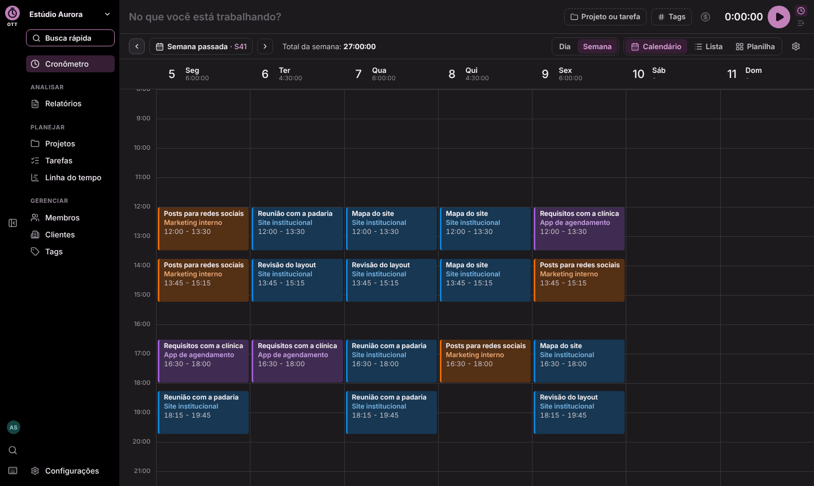
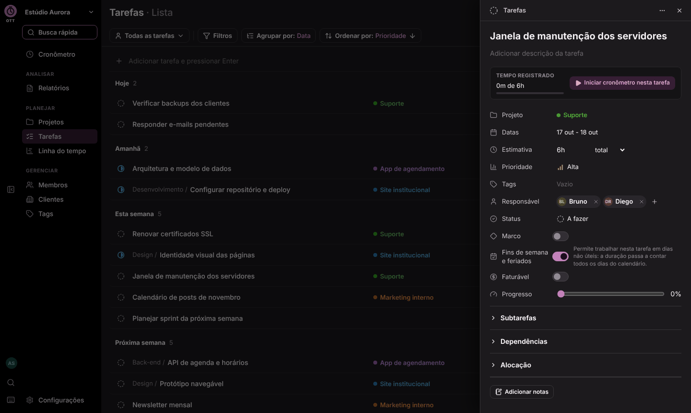
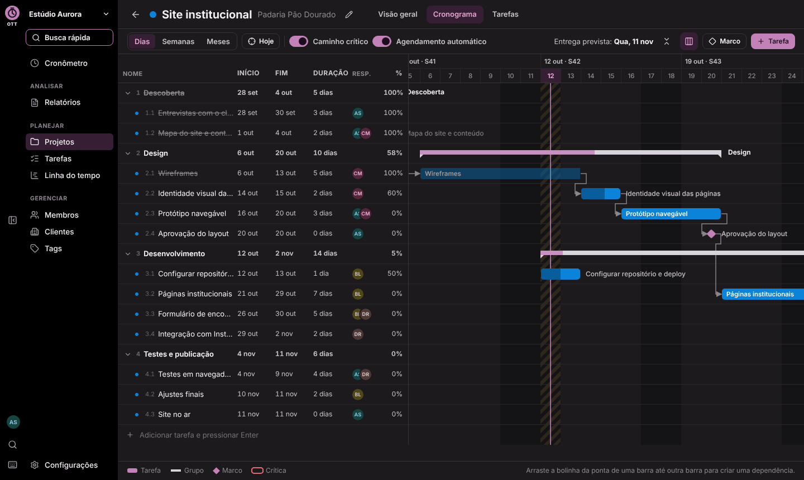
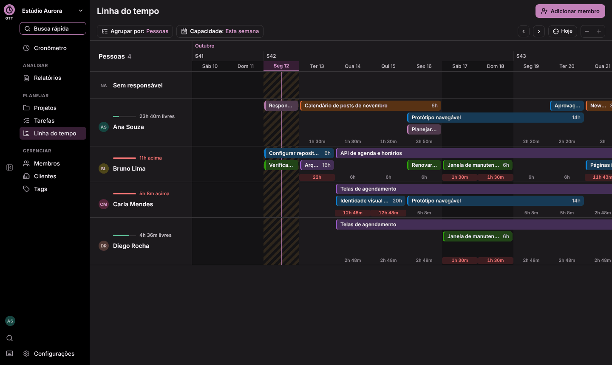
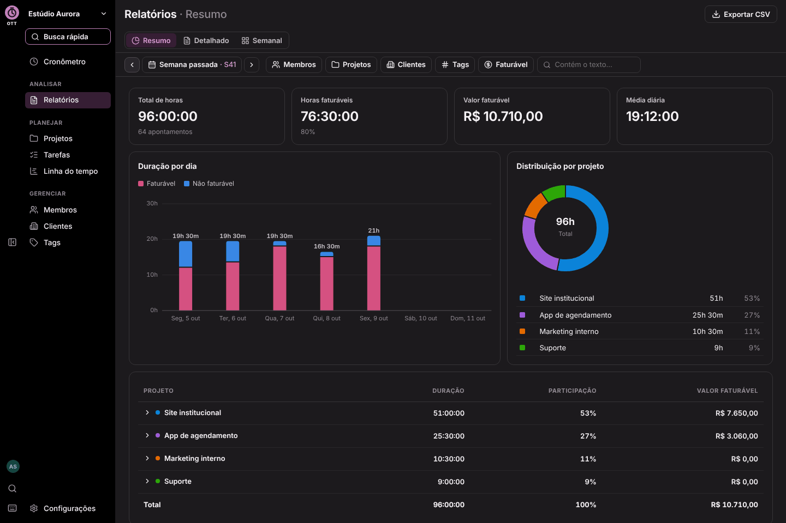
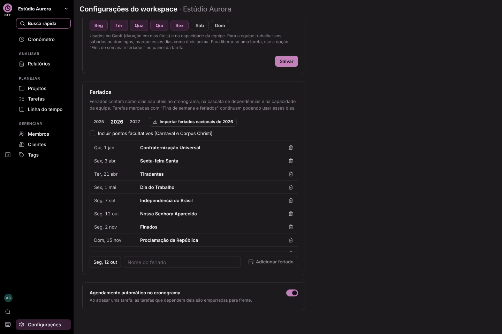

# Documentação do Open Task Tracker

Dez documentos de referência para manter o conhecimento e o padrão do projeto. Quem
for alterar o código (pessoa ou agente de IA) começa pelo documento 00.

| Documento | Quando ler |
|---|---|
| [00-regras-para-ia.md](00-regras-para-ia.md) | **Sempre, antes de qualquer alteração.** Regras obrigatórias, regras do domínio e checklist de fim de tarefa |
| [01-arquitetura.md](01-arquitetura.md) | Pacotes do monorepo, modo Firebase ou local, camada de dados, boot, fluxo de dados na web, rotas de tela |
| [02-tecnologias.md](02-tecnologias.md) | Versões, scripts, variáveis de ambiente, build, GitHub Actions e publicação no GitHub Pages |
| [03-identidade-visual.md](03-identidade-visual.md) | Tokens de cor dos dois temas, cores de gráfico, tipografia, ícones, ilustrações |
| [04-padrao-ui-e-componentes.md](04-padrao-ui-e-componentes.md) | Anatomia das telas, padrões de interação e inventário de componentes e hooks |
| [05-padroes-de-codigo-e-nomes.md](05-padroes-de-codigo-e-nomes.md) | Nomes de arquivos, código, coleções, rotas e textos; granularidade; comentários; testes; git |
| [06-dados-e-armazenamento.md](06-dados-e-armazenamento.md) | Coleções do Firestore e do lowdb, regras de acesso, operações da camada de dados, relatórios, códigos de erro, dados do navegador |
| [07-fluxos-aplicacao.md](07-fluxos-aplicacao.md) | Modo de dados, login, convites, cronômetro, tarefas, Gantt, feriados, capacidade, relatórios |
| [08-planejamento-gantt-e-algoritmos.md](08-planejamento-gantt-e-algoritmos.md) | Calendário de trabalho, dependências, cascata, caminho crítico, capacidade, geometria |
| [09-contexto-do-produto.md](09-contexto-do-produto.md) | Visão do produto, correspondência com o Toggl, glossário, roteiro |

## Marcadores de estado

- `[implementado]`: existe no código e tem teste quando é regra.
- `[em andamento]`: começou, ainda não está completo.
- `[planejado]`: decidido, não começou.

## Telas

| Cronômetro (calendário semanal) | Tarefas e painel lateral |
|---|---|
|  |  |

| Cronograma (Gantt) | Linha do tempo (capacidade) |
|---|---|
|  |  |

| Relatórios | Feriados nas configurações |
|---|---|
|  |  |
